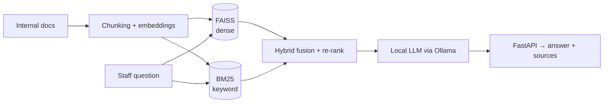

# Hi, I'm Muhammad Kumail 👋

### AI Engineer · I build RAG pipelines and multi-agent LLM systems that ship

---

## 🧠 About me

- 🏦 **AI Engineering Intern @ HBL** (Pakistan's largest bank) — sole engineer on an **offline, privacy-first RAG assistant** for internal staff. Hybrid retrieval (FAISS + BM25) lifted answer accuracy from **45% → 80%**, with zero cloud dependency.
- 🏆 **1st place, AI Mustaqbil 2.0** — shipped a **6-agent financial intelligence platform** in 24 hours with a 3-person team.
- 🎓 **BS Computer Science @ FAST-NUCES** (Karachi), graduating **Jun 2027**.
- 📜 IBM AI Developer Professional Certificate · Google AI Essentials · Microsoft Azure AI Fundamentals
- 🔭 **Open to:** AI/ML engineering internships and new-grad roles, plus hackathon teams building with LLMs.

---

## 🚀 Featured projects

<table>
<tr>
<td width="50%" valign="top">

### 🏆 [FreelanceFlow](https://github.com/muhammadkumail1/FreelanceFlow)
**1st place, AI Mustaqbil 2.0 (86/100).** Six concurrent LLM agents (FX rates, platform fees, FBR tax rules, conflict resolution) tell Pakistani freelancers **when and how to withdraw** so they keep the 4–8% usually lost to fees.

`FastAPI` `asyncio` `WebSockets` `React` `Groq · Llama 3`

</td>
<td width="50%" valign="top">

### 🔬 [The AI Scientist](https://github.com/muhammadkumail1/Klayr) · [**live**](https://klayr.vercel.app)
**Hack-Nation × Fulcrum Science.** Turns a plain-English hypothesis into a lab-ready experiment plan (literature QC, protocol, biosafety, risks) in **under 60 seconds** with an 8-node LangGraph pipeline streamed over SSE.

`LangGraph` `FastAPI` `PostgreSQL` `Redis` `Docker` `TypeScript`

</td>
</tr>
<tr>
<td width="50%" valign="top">

### 🛡️ [SpamShield](https://github.com/muhammadkumail1/SpamShield)
An email spam detector with a **live 9-stage analysis pipeline** streamed over Server-Sent Events. Built in **both Node/Express and [Python/FastAPI](https://github.com/muhammadkumail1/AI_Project)**, with rate limiting, security headers and tests.

`React` `Express 5` `FastAPI` `SSE` `pytest`

</td>
<td width="50%" valign="top">

### 📋 [DevTrack](https://github.com/muhammadkumail1/DevTrack)
A lightweight Jira alternative for student teams and small software houses: sprints, tasks, bug tracking, **role-based access control** and a live progress dashboard.

`MongoDB` `Express` `React` `Node.js` `RBAC`

</td>
</tr>
</table>

---

## 🏗️ How I build RAG (HBL internship, private codebase)

> Fully on-prem with no data leaving the bank. Moving from plain vector search to hybrid retrieval and tuning the chunking took accuracy from **45% to 80%**.

---

## 🛠️ Tech stack

**AI / LLM**

**Backend**

**Frontend & tools**

---

## 📊 GitHub activity

  
  
   
  

---

**Building something with LLMs? Let's talk:** [LinkedIn](https://www.linkedin.com/in/muhammad-kumail1) · [Email](mailto:kumail.muhammad2004@gmail.com)

